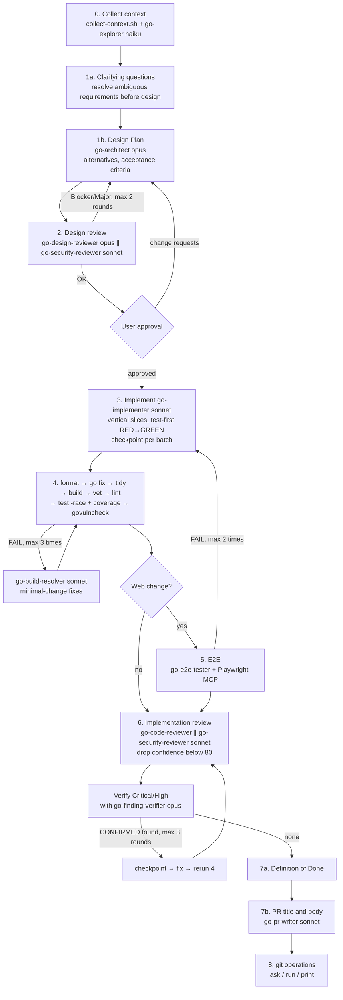

# go-workflow

A Claude Code workflow plugin for Go development. It takes a task from design through PR creation and git operations, running each phase in a subagent on the model best suited to it.
It detects each repository's `CLAUDE.md` / `AGENTS.md` / `.claude/rules` / `.claude/agents` / `.claude/skills` / Makefile, and **gives the repository's own conventions and tools top priority**.

## Installation

```bash
claude plugin marketplace add keneanderson/claude-go-workflow
claude plugin install go-workflow@go-dev-marketplace
# Recommended: gopls (used by the bundled gopls MCP server; improves impact analysis, reference search and diagnostics)
go install golang.org/x/tools/gopls@latest
# Optional: if you also want the editor-style LSP tools
claude plugin install gopls-lsp@claude-plugins-official
```

## Flow



## Commands

| Command | Description |
|---------|-------------|
| `/go-workflow:dev <task or Issue URL>` | Run all phases end to end. `--resume` (resume automatically from state.json), `--from=<phase>`, `--git=ask\|run\|print`, `--no-e2e`, `--draft`, `--max-review=N`, `--alternatives`, `--worktree` |
| `/go-workflow:design <task>` | Clarifying questions → design |
| `/go-workflow:design-review` | Design review and approval |
| `/go-workflow:implement` | Implement the approved design |
| `/go-workflow:quality` | lint / format / test / modernize / coverage (`--no-fix`, `--all`) |
| `/go-workflow:e2e` | Verify behavior with Playwright |
| `/go-workflow:review` | Implementation review loop on the current diff (works without a design doc) |
| `/go-workflow:pr` | Definition of Done check → PR title and body |
| `/go-workflow:ship` | git operations (branch, commit, push, `gh pr create`) |

The `go-conventions` skill is referenced automatically. It contains a modern-Go replacement table up to Go 1.27 with upgrade checks, a security checklist, a collection of Go pitfalls, architecture guidelines, and the Definition of Done.

## Model assignments and rationale

| Phase | Agent | Model | Rationale |
|-------|-------|-------|-----------|
| Code exploration | go-explorer | **haiku** | Mostly reading, in large volume. Fast and cheap |
| Design | go-architect | **opus** | Mistakes propagate to every later phase, so this needs the strongest reasoning |
| Design review | go-design-reviewer | **opus** (recommended) | The design doc is short, so the cost is low, while a missed issue costs the most. Verified independently in a separate context |
| Security | go-security-reviewer | sonnet | Checklist-driven, so sonnet is enough. Runs in parallel in both the design and implementation reviews |
| Implementation and fixes | go-implementer | **sonnet** | With a concrete design, sonnet gives the best balance of speed, quality and cost |
| Fixing quality-check failures | go-build-resolver | sonnet | Specialized in surgical minimal-change fixes (loosening configs and deleting tests are forbidden) |
| E2E | go-e2e-tester | sonnet | Browser operation and result judgment |
| Implementation review | go-code-reviewer | **sonnet** | Diffs tend to be large and the review runs several rounds, so cost efficiency matters |
| Finding verification | go-finding-verifier | opus | Verifies only Critical/High findings one at a time, so the volume and context are small, and it is very effective at stopping fix loops caused by false positives |
| PR creation | go-pr-writer | sonnet (recommended) | Judging impact and compatibility calls for sonnet rather than haiku |

To change a model, edit the agent's `model:` field, or override it by placing an agent with the same role in the repository's `.claude/agents/`.

### Subagent status and escalation

Implementation agents (go-implementer / go-build-resolver) return `STATUS: DONE | DONE_WITH_CONCERNS | NEEDS_CONTEXT | BLOCKED` on the first line, and the orchestrator chooses, based on the status, to add information, restart with a fresh opus agent, split the work, or revisit the design. It never simply repeats the same request.
An implementation that fails twice in the same batch, or a finding still unfixed in the final review round, is handed over to a fresh go-implementer with `model: opus`, together with the history file.

### Evidence-based completion

Before saying anything "passes" or "is fixed", the orchestrator runs the command right then and checks the output (a subagent's success report or an earlier result does not count as evidence). Just before creating the PR, it reruns the quality checks in check mode and saves the output to `verify.log`, and the tests and coverage in the PR body are written from it.

### Loop limits

- Design review: **up to 2 rounds** (after that, the user decides)
- Implementation review: **up to 3 rounds**. From the second round on, it is a re-review of only the diff fixed since the previous round (ADDRESSED / NOT ADDRESSED plus new breakage caused by the fixes; out-of-scope observations are only noted). Round 1 finds most issues, round 2 confirms fixes and detects regressions, and round 3 confirms convergence. Beyond that, the loop tends to churn (minor findings bloat the diff), so anything that remains goes back to a human as a design-level problem. To prevent churn from false positives, a confidence filter (80 or above) and verification by opus come before any fix
- Quality-check fixes: up to 3 times / E2E fixes: up to 2 times

## Reading repository settings

`scripts/collect-context.sh` writes the following to `RUN_DIR/context.md`, and every agent starts from it.

- `CLAUDE.md` / `CLAUDE.local.md` / `AGENTS.md` (including nested ones; a nested file applies only under its directory), `.claude/rules/**`, `.github/copilot-instructions.md`, `.cursor/rules`, CONTRIBUTING, ADRs
- `.claude/agents` (name, model, description), `.claude/skills`, `.claude/commands`, `.mcp.json`
- Makefile / Taskfile targets, `.golangci.yml`, pre-commit / lefthook, sqlc / buf / mockgen, CI
- The go directive (used to decide which modern features are available), whether gopls is installed, whether it is a web app, the PR template

Priority: **repository conventions > existing patterns > design doc > this plugin's defaults**.
The repository's own review agents, lint skills, `make lint` and so on take precedence or run alongside in each phase.

## Project settings (optional): `.claude/go-workflow.json`

See [examples/go-workflow.json](examples/go-workflow.json).

| Key | Description |
|-----|-------------|
| `commands.<format\|modernize\|lint\|test\|vet\|vuln>` | Override a quality-check command (`"skip"` disables it) |
| `commands.formatFile` | Format command used by the post-edit hook |
| `web.startCommand / baseURL / healthcheck / env` | How to start the app for E2E |
| `git.mode` / `git.draft` | git operation mode |
| `hooks.formatOnEdit` / `hooks.protectConfig` | Enable or disable the hooks |
| `dod` | Extra items for the Definition of Done |

## Artifacts and state

Everything is saved under `<repo>/.claude/go-workflow/runs/<timestamp>-<slug>/`, which is registered in `.git/info/exclude` automatically so it is never committed.

```
state.json  workflow.md  task.md  context.md  exploration.md  clarifications.md
design.md  design-review.md  implement.md  quality.log  coverage.out
e2e.md  e2e/*.png  review-1.md  security-1.md  dod.md  pr.md  pr-meta.txt  checkpoints.txt
```

- `scripts/run-dir.sh status` shows each phase's state and the resume point (`resume_from`). `/go-workflow:dev --resume` uses it to resume
- `scripts/checkpoint.sh` saves a snapshot of the working tree to `refs/go-workflow/<run>/<name>` before each implementation batch and review fix (it never touches commits, branches or the index, and is never pushed). `restore` rolls back to it

## MCP servers (bundled)

| Server | Purpose |
|--------|---------|
| `gopls` (`gopls mcp`) | `go_workspace` / `go_search` / `go_file_context` / `go_package_api` / `go_symbol_references` (impact before a change) / `go_diagnostics` (check after an edit) / `go_vulncheck` (vulnerability check with reachability). Requires gopls v0.20+. If gopls is not found, the server does not start and agents fall back to `git grep` and the like |
| `playwright` | Browser operation for E2E |

## Hooks

| Event | Description |
|-------|-------------|
| PreToolUse (Edit/Write) | Changes to existing `.golangci.*` / pre-commit / lefthook / CI workflow files require user confirmation (ask). Adding a `//nolint` without a reason is denied (`//nolint:<linter> // <reason>` is allowed) |
| PostToolUse (Edit/Write) | Formats `.go` files with `goimports` (or `gofmt` if unavailable), and also gofumpt if the repository uses it. Generated code is skipped |

## Evals

`evals/` contains cases that measure the plugin's effect (modernizing for Go 1.27, not using features beyond the go directive, reviewing for pitfalls).

```bash
claude plugin eval ./plugins/go-workflow --runs 3 --no-publish
```

A comparison against running without the plugin (ablation) is done automatically.

## Requirements

- Go (modernize via `go fix` needs Go 1.26+; on older versions, `golang.org/x/tools` modernize is run with `go run`), `jq`
- Recommended: `golangci-lint` (**built with the Go version you are using**; one built with an older Go is reported as ENV), `goimports`, `govulncheck`, `gopls`, `gh`
- Web E2E: Node.js (`npx @playwright/mcp`). The first run may need `npx playwright install chromium`

## Limitations

- In a multi-module layout (without go.work), only the module of the first go.mod found is targeted. Override this with `commands` in `.claude/go-workflow.json`
- If the Makefile has `fmt` / `lint` / `test` targets, they are used instead, so `make fmt` may rewrite files even with `--no-fix`. When the Makefile's test target is used, no coverage is reported

## Repositories that informed the design

The following were studied and their ideas adopted (no code was copied).

| Repository | What was adopted |
|------------|------------------|
| [affaan-m/ECC](https://github.com/affaan-m/ECC) | Minimal-change build-fix agent, a hook that prevents loosening lint configs, checks for silent failures, prompt-injection defenses for external content |
| [addyosmani/agent-skills](https://github.com/addyosmani/agent-skills) | Definition of Done, acceptance criteria, incremental implementation in vertical slices, test-first (RED→GREEN), checking APIs against primary sources |
| [anthropics/claude-plugins-official](https://github.com/anthropics/claude-plugins-official) | Clarifying questions before design, comparing designs with different approaches, the confidence-80 filter and independent verification of findings, scoping of nested CLAUDE.md files, using gopls-lsp alongside |
| [wshobson/agents](https://github.com/wshobson/agents) | Phase state tracking and resume via state.json, checkpoints and rollback per logical unit |
| [samber/cc-skills-golang](https://github.com/samber/cc-skills-golang) | Modernization up to Go 1.27 (adopted after checking the official release notes) and upgrade checks, a collection of Go pitfalls, using the gopls MCP, skill eval cases |
| [obra/superpowers](https://github.com/obra/superpowers) | Verification before completion, technically verifying review findings and fixing them one at a time, narrowly scoped re-reviews, implementer status reports and handover to a stronger model, debugging by finding the root cause before fixing, concrete plan steps, isolation with worktrees |
