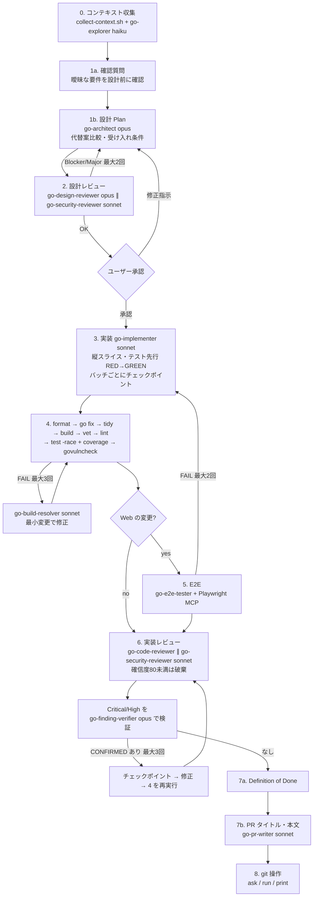

# go-workflow

Go 開発のための Claude Code ワークフロープラグイン。設計からPR作成・git 操作までを、フェーズごとに適したモデルのサブエージェントで進めます。
各リポジトリの `CLAUDE.md` / `AGENTS.md` / `.claude/rules` / `.claude/agents` / `.claude/skills` / Makefile を検出し、**リポジトリの規約と独自ツールを最優先** で使います。

## インストール

```bash
claude plugin marketplace add keneanderson/claude-go-workflow
claude plugin install go-workflow@go-dev-marketplace
# 推奨: gopls（同梱の gopls MCP サーバーが使う。影響範囲分析・参照検索・診断の精度が上がる）
go install golang.org/x/tools/gopls@latest
# 任意: エディタ型の LSP ツールも使う場合
claude plugin install gopls-lsp@claude-plugins-official
```

## フロー



## コマンド

| コマンド | 内容 |
|----------|------|
| `/go-workflow:dev <タスク or Issue URL>` | 全フェーズを通しで実行。`--resume`（state.json から自動再開）、`--from=<phase>`、`--git=ask\|run\|print`、`--no-e2e`、`--draft`、`--max-review=N`、`--alternatives`、`--worktree` |
| `/go-workflow:design <タスク>` | 確認質問 → 設計 |
| `/go-workflow:design-review` | 設計レビュー＋承認 |
| `/go-workflow:implement` | 承認済み設計の実装 |
| `/go-workflow:quality` | lint / format / test / modernize / coverage（`--no-fix`, `--all`） |
| `/go-workflow:e2e` | Playwright で動作確認 |
| `/go-workflow:review` | 現在の差分の実装レビューループ（設計書なしでも使える） |
| `/go-workflow:pr` | DoD 確認 → PR タイトル・本文の作成 |
| `/go-workflow:ship` | git 操作（ブランチ・コミット・push・`gh pr create`） |

`go-conventions` スキル（Go 1.27 までのモダン Go 置き換え表とバージョンアップ時の確認、セキュリティチェックリスト、Go の落とし穴集、アーキテクチャ指針、Definition of Done）は自動参照されます。

## モデル割り当てと理由

| フェーズ | エージェント | モデル | 理由 |
|----------|--------------|--------|------|
| コード調査 | go-explorer | **haiku** | 読み取り中心で量が多い。速くて安い |
| 設計 | go-architect | **opus** | 誤りが後工程すべてに波及するため最も推論力が必要 |
| 設計レビュー | go-design-reviewer | **opus**（推奨） | 設計書は短くコストが小さい一方、見落としのコストが最大。別コンテキストで独立検証 |
| セキュリティ | go-security-reviewer | sonnet | チェックリスト駆動で sonnet で十分。設計・実装レビューの両方で並列実行 |
| 実装・修正 | go-implementer | **sonnet** | 設計が具体的なら実装は sonnet が速度・品質・コストのバランス最良 |
| 品質チェック失敗の修正 | go-build-resolver | sonnet | 最小変更の外科的修正に特化（設定の緩和・テスト削除を禁止） |
| E2E | go-e2e-tester | sonnet | ブラウザ操作と結果判定 |
| 実装レビュー | go-code-reviewer | **sonnet** | 差分が大きくなりがちで回数も回すためコスト効率重視 |
| 指摘の検証 | go-finding-verifier | opus | Critical/High だけを 1 件ずつ検証するので件数・文脈が小さく、誤検知による修正ループを止める効果が大きい |
| PR 作成 | go-pr-writer | sonnet（推奨） | 影響範囲・互換性の判断が要るため haiku より sonnet |

モデルを変えたい場合は、各エージェントの `model:` を書き換えるか、リポジトリの `.claude/agents/` に同じ役割のエージェントを置いて上書きします。

### サブエージェントの状態と昇格

実装系エージェント（go-implementer / go-build-resolver）は 1 行目に `STATUS: DONE | DONE_WITH_CONCERNS | NEEDS_CONTEXT | BLOCKED` を返し、オーケストレーターは状態に応じて「情報を足す / opus で新しく起動し直す / 分割する / 設計を見直す」を選びます。同じ依頼をそのまま繰り返すことはしません。
同じバッチで 2 回失敗した実装や、レビューの最終ラウンドでも直らない指摘は、`model: opus` の新しい go-implementer に経緯ファイルごと引き継ぎます。

### 証拠に基づく完了

「通った」「直った」と言う前に、そのコマンドをその場で実行して出力を確認します（サブエージェントの成功報告や以前の結果は証拠にしない）。PR 作成直前には品質チェックをチェックモードで取り直して `verify.log` に保存し、PR 本文のテスト・カバレッジはそれを根拠に書きます。

### ループ回数

- 設計レビュー: **最大 2 ラウンド**（その後はユーザー判断）
- 実装レビュー: **最大 3 回**。2 回目以降は前回からの修正差分だけを見る再レビュー（ADDRESSED / NOT ADDRESSED と修正による新たな破損のみ、スコープ外の気付きはメモ止まり）。1 回目で大半を検出、2 回目で修正確認と回帰検出、3 回目で収束確認。それ以上は churn（軽微な指摘で差分が膨らむ）になりやすく、残るなら設計レベルの問題として人間に戻す。誤検知による churn を防ぐため、修正前に確信度フィルタ（80 以上）と opus による検証を挟む
- 品質チェック修正: 最大 3 回 / E2E 修正: 最大 2 回

## リポジトリ設定の参照

`scripts/collect-context.sh` が `RUN_DIR/context.md` に以下を書き出し、全エージェントがこれを起点に動きます。

- `CLAUDE.md` / `CLAUDE.local.md` / `AGENTS.md`（ネスト含む。ネストしたものはそのディレクトリ配下にだけ適用）、`.claude/rules/**`、`.github/copilot-instructions.md`、`.cursor/rules`、CONTRIBUTING、ADR
- `.claude/agents`（名前・モデル・説明）、`.claude/skills`、`.claude/commands`、`.mcp.json`
- Makefile / Taskfile のターゲット、`.golangci.yml`、pre-commit / lefthook、sqlc / buf / mockgen、CI
- go ディレクティブ（使えるモダン機能の判定に使用）、gopls の有無、Web 判定、PR テンプレート

優先順位: **リポジトリ規約 > 既存パターン > 設計書 > 本プラグインの既定値**。
リポジトリ独自のレビュー agent や lint skill、`make lint` などはフェーズで優先・併用されます。

## プロジェクト設定（任意）: `.claude/go-workflow.json`

[examples/go-workflow.json](examples/go-workflow.json) を参照。

| キー | 内容 |
|------|------|
| `commands.<format\|modernize\|lint\|test\|vet\|vuln>` | 品質チェックのコマンド上書き（`"skip"` で無効化） |
| `commands.formatFile` | 編集後フックで使う整形コマンド |
| `web.startCommand / baseURL / healthcheck / env` | E2E のアプリ起動情報 |
| `git.mode` / `git.draft` | git 操作のモード |
| `hooks.formatOnEdit` / `hooks.protectConfig` | フックの有効・無効 |
| `dod` | Definition of Done に追加する項目 |

## 成果物と状態管理

`<repo>/.claude/go-workflow/runs/<timestamp>-<slug>/` に保存され、`.git/info/exclude` に自動登録されるためコミットされません。

```
state.json  workflow.md  task.md  context.md  exploration.md  clarifications.md
design.md  design-review.md  implement.md  quality.log  coverage.out
e2e.md  e2e/*.png  review-1.md  security-1.md  dod.md  pr.md  pr-meta.txt  checkpoints.txt
```

- `scripts/run-dir.sh status` で各フェーズの状態と再開ポイント（`resume_from`）を確認できます。`/go-workflow:dev --resume` はこれを使って再開します
- `scripts/checkpoint.sh` は実装バッチ・レビュー修正の前に作業ツリーのスナップショットを `refs/go-workflow/<run>/<name>` に保存します（コミット・ブランチ・インデックスには触れず、push もされません）。`restore` で戻せます

## MCP サーバー（同梱）

| サーバー | 用途 |
|----------|------|
| `gopls`（`gopls mcp`） | `go_workspace` / `go_search` / `go_file_context` / `go_package_api` / `go_symbol_references`（変更前の影響範囲）/ `go_diagnostics`（編集後の確認）/ `go_vulncheck`（到達可能性つき脆弱性チェック）。gopls v0.20+ が必要。見つからなければ起動せず、エージェントは `git grep` 等にフォールバック |
| `playwright` | E2E のブラウザ操作 |

## フック

| イベント | 内容 |
|----------|------|
| PreToolUse（Edit/Write） | 既存の `.golangci.*` / pre-commit / lefthook / CI ワークフローの変更はユーザー確認（ask）。理由のない `//nolint` の追加は拒否（`//nolint:<linter> // <理由>` は可） |
| PostToolUse（Edit/Write） | `.go` ファイルを `goimports`（なければ `gofmt`）で整形。リポジトリが gofumpt を使っていれば gofumpt も。生成コードはスキップ |

## 評価（evals）

`evals/` にプラグインの効果を測るケースがあります（Go 1.27 向けモダナイズ、go ディレクティブを超える機能を使わないこと、落とし穴のレビュー）。

```bash
claude plugin eval ./plugins/go-workflow --runs 3 --no-publish
```

プラグインなしとの比較（ablation）も自動で行われます。

## 必要なもの

- Go（`go fix` による modernize は Go 1.26+。それ以前は `golang.org/x/tools` の modernize を `go run`）、`jq`
- 推奨: `golangci-lint`（**使用中の Go でビルドしたもの**。古い Go でビルドされていると ENV として報告）、`goimports`、`govulncheck`、`gopls`、`gh`
- Web の E2E: Node.js（`npx @playwright/mcp`）。初回は `npx playwright install chromium` が必要な場合あり

## 制約

- マルチモジュール構成（go.work なし）では最初に見つかった go.mod のモジュールのみを対象にします。`.claude/go-workflow.json` の `commands` で上書きしてください
- Makefile の `fmt` / `lint` / `test` ターゲットがある場合はそれを使うため、`--no-fix` でも `make fmt` が書き換えを行うことがあります。Makefile の test を使う場合はカバレッジは出ません

## 参考にしたリポジトリ

設計にあたり以下を調査し、考え方を取り入れました（コードの流用はしていません）。

| リポジトリ | 取り入れたもの |
|------------|----------------|
| [affaan-m/ECC](https://github.com/affaan-m/ECC) | 最小変更のビルド修正エージェント、lint 設定の緩和を防ぐフック、サイレントな失敗の検出観点、外部コンテンツのプロンプトインジェクション対策 |
| [addyosmani/agent-skills](https://github.com/addyosmani/agent-skills) | Definition of Done、受け入れ条件、縦スライスの段階実装、テスト先行（RED→GREEN）、一次情報で API を確認する方針 |
| [anthropics/claude-plugins-official](https://github.com/anthropics/claude-plugins-official) | 設計前の確認質問、複数方針の設計比較、確信度 80 フィルタと指摘の独立検証、ネストした CLAUDE.md のスコープ、gopls-lsp の併用 |
| [wshobson/agents](https://github.com/wshobson/agents) | state.json によるフェーズ状態管理と再開、論理単位のチェックポイントとロールバック |
| [samber/cc-skills-golang](https://github.com/samber/cc-skills-golang) | Go 1.27 までのモダナイズ（公式リリースノートで裏取りして採用）とバージョンアップ時の確認、Go の落とし穴集、gopls MCP の活用、スキルの評価ケース |
| [obra/superpowers](https://github.com/obra/superpowers) | 証拠に基づく完了（verification before completion）、レビュー指摘の技術的な検証と 1 件ずつの修正、スコープを絞った再レビュー、実装者の状態報告と上位モデルへの引き継ぎ、根本原因を特定してから直すデバッグ、計画ステップの具体化、worktree による隔離 |
